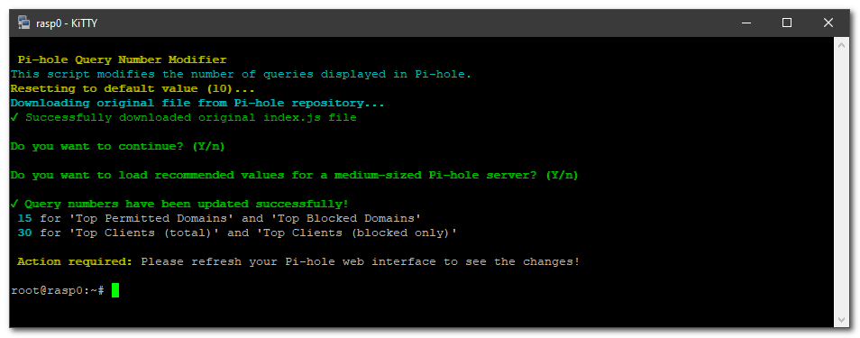
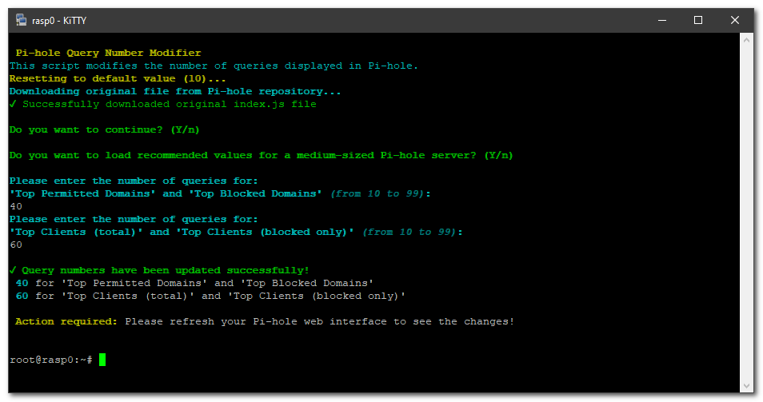
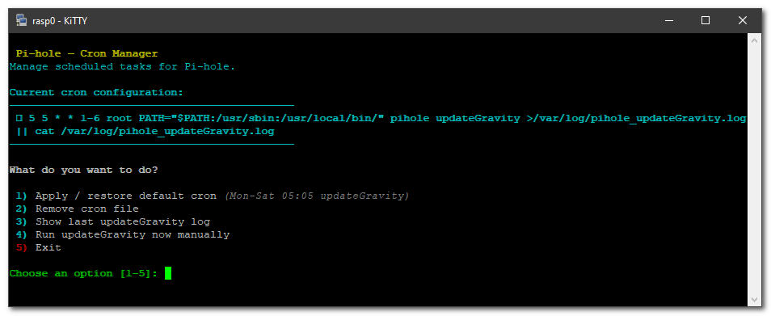
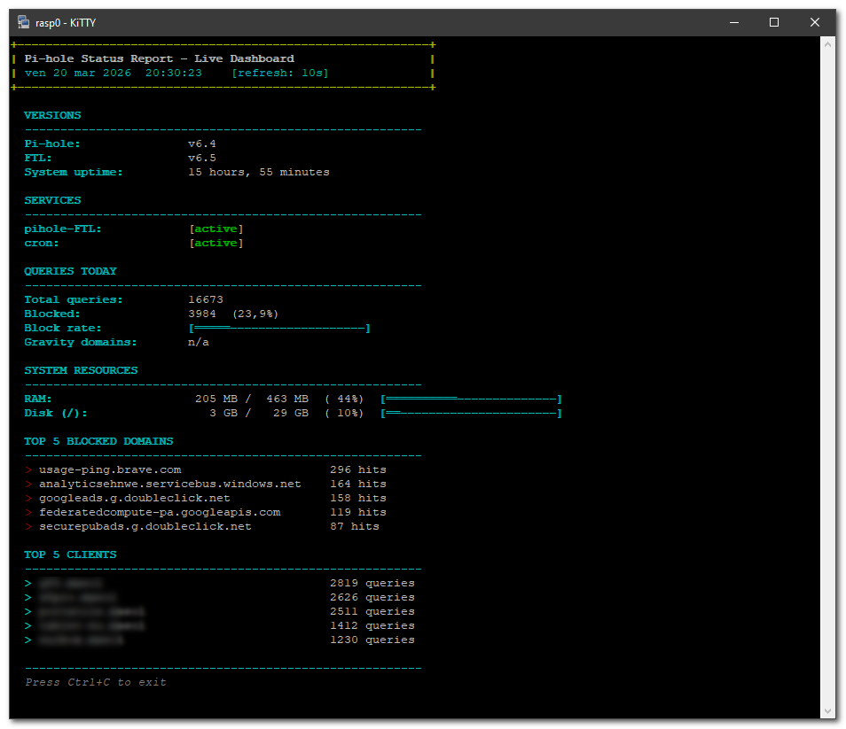
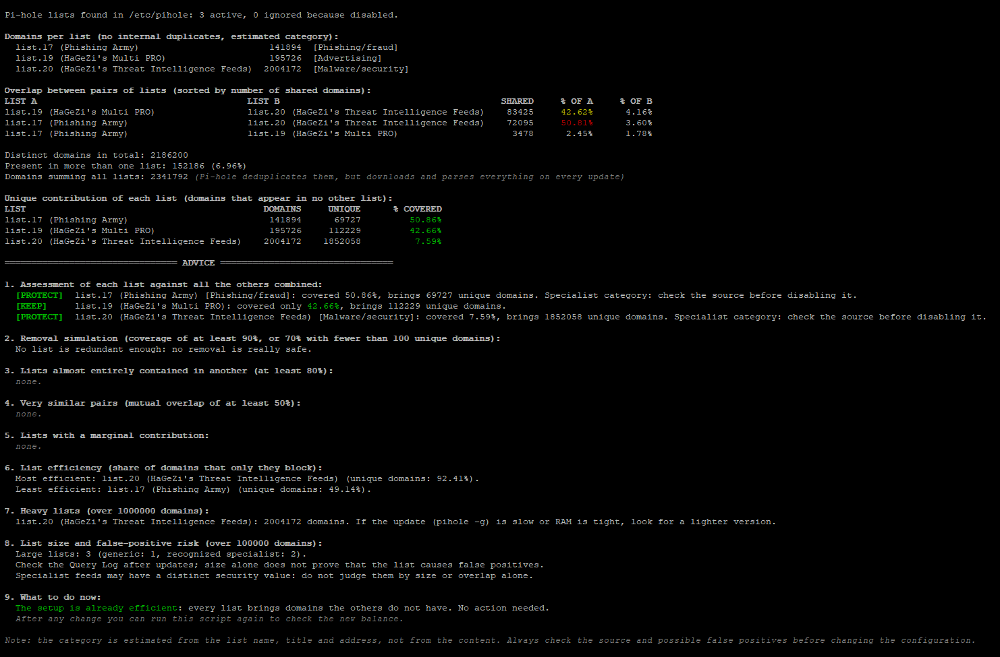

<p align="center">
  
  
</p>

<h1 align="center">🛠️ Pi-hole Scripts Collection</h1>

<p align="center">
  <strong>A collection of utility scripts to extend and customize your Pi-hole installation.</strong>
</p>

<p align="center">
  <a href="#overview">Overview</a> •
  <a href="#scripts">Scripts</a> •
  <a href="#install">Install</a> •
  <a href="#usage">Usage</a> •
  <a href="#troubleshooting">Troubleshooting</a>
</p>

<p align="center">
  <a href="https://ko-fi.com/mapi68">
    
  </a>
</p>

---

## 🌟 Overview <a name="overview"></a>

A growing collection of Bash scripts to manage, customize, and extend Pi-hole beyond its default capabilities — including dashboard tweaks, cron job management, live system monitoring, and blocklist analysis.

---

## 📦 Scripts <a name="scripts"></a>

### 📊 1. Pi-hole Query Number Modifier

Modify how many entries are displayed in the Pi-hole dashboard (Top Permitted Domains, Top Blocked Domains, Top Clients).

#### Features

| Feature | Description |
|---|---|
| 🔄 **Reset** | Restore default values (10 queries) |
| ⚡ **Optimal Mode** | Predefined values tuned for medium-sized servers |
| 🎛️ **Manual Mode** | Custom configuration from 10 to 99 queries |
| 🎨 **Color Output** | Color-coded terminal interface |
| 🖥️ **Interactive UI** | User-friendly guided setup |

#### Configuration

**Optimal Mode** — Sets Top Domains to 15 entries and Top Clients to 30 entries.



**Manual Mode** — Full control over all query number settings (10–99).



---

### ⏰ 2. Pi-hole Cron Manager

Manage Pi-hole scheduled tasks from an interactive menu. Applies, removes, and monitors cron jobs for Pi-hole — with no manual editing of cron files required.

#### Features

| Feature | Description |
|---|---|
| ✅ **Apply / Restore** | Writes the default schedule to `/etc/cron.d/pihole_custom` and restarts cron |
| 🗑️ **Remove** | Deletes the cron file with confirmation |
| 📋 **Show Log** | Displays the last 30 lines of the updateGravity log |
| ▶️ **Run Now** | Runs `updateGravity` immediately with live output |
| 🖥️ **Interactive UI** | Menu-driven with return-to-menu after each action |

#### Default Schedule

```
5 5 * * 1-6   root   pihole updateGravity > /var/log/pihole_updateGravity.log
```

> **updateGravity** runs Monday through Saturday at **05:05**, with output saved to `/var/log/pihole_updateGravity.log`.



---

### 📡 3. Pi-hole Status Report

A live terminal dashboard that auto-refreshes every 10 seconds, showing a full overview of your Pi-hole instance — functionality not available natively in Pi-hole.

#### Features

| Feature | Description |
|---|---|
| 🔄 **Live Refresh** | Auto-updates every 10 seconds |
| 📦 **Versions** | Pi-hole and FTL current version |
| ⏱️ **Uptime** | System uptime at a glance |
| ⚙️ **Services** | Status of pihole-FTL and cron |
| 📊 **Queries Today** | Total queries, blocked count, block rate with visual bar |
| 🌍 **Gravity** | Number of domains in the gravity database |
| 💾 **Resources** | RAM and disk usage with visual bars |
| 🚫 **Top Blocked Domains** | Top 5 domains blocked today |
| 🖥️ **Top Clients** | Top 5 clients by query count |

#### Notes

- Uses the Pi-hole REST API (`/api/`) for all data
- Authenticates automatically via `/etc/pihole/cli_pw`
- Press `Ctrl+C` to exit cleanly



---

### 🔍 4. Pi-hole Overlap Audit

Find out which of your blocklists are redundant. For every pair of lists it shows the percentage of shared domains, then gives advice on what to keep, review or remove. It only reads your lists: nothing in your Pi-hole configuration is changed.

#### Features

| Feature | Description |
|---|---|
| 🔎 **Auto-detection** | Finds the lists downloaded by Pi-hole in `/etc/pihole` and `/etc/pihole/listsCache`, otherwise uses the files in the script folder |
| ✅ **Active Lists Only** | With `sqlite3` installed, reads `gravity.db` to skip disabled lists, show the name of each list and warn about enabled lists that have no downloaded file yet |
| 📊 **Pairwise Overlap** | Shared domains and percentage for every pair of lists, with color-coded highlights |
| 🎯 **Unique Contribution** | Domains that only each list blocks, and how much of each list is covered by the others |
| 🧪 **Removal Simulation** | Removes redundant lists one at a time, recomputing the unique contribution after each step |
| 🛡️ **Protected Lists** | Phishing, malware, privacy and tracker lists are never suggested for automatic removal |
| 📄 **Formats** | Plain domains, hosts files and Adblock syntax |
| 🌐 **Languages** | English by default, Italian with `--it` |

#### Advice

Each list gets a verdict, followed by a short action plan:

| Verdict | Meaning |
|---|---|
| 🟢 **KEEP** | The list brings many domains the others do not have |
| 🟡 **REVIEW** | Mostly covered by the other lists, removing it would lose some unique domains |
| 🔴 **REMOVE** | Almost entirely covered by the other lists, with very few unique domains |
| 🛡️ **PROTECT** | Specialist category (phishing, malware, privacy, trackers): check the source before disabling |

#### Options

| Option | Description |
|---|---|
| `-h`, `--help` | Show the help |
| `--it` | Show all text in Italian |
| `--color` | Force colors even when the output is redirected (useful with `less -R`) |
| `--no-color` | Disable colors |
| `--no-clear` | Do not clear the screen at startup |
| `--no-sqlite` | Do not read `gravity.db`: analyze all the lists found (including disabled ones) and take the names from the files only |

#### Notes

- Without arguments it analyzes the lists downloaded by Pi-hole (v5 and v6 locations); pass a folder or two or more list files to compare specific lists
- The category of each list is estimated from its name, title and address, not verified against the source
- The thresholds used for the advice are editable at the top of the script
- Set `PIHOLE_DIR` to use a Pi-hole folder other than `/etc/pihole`

<!-- TODO: add the screenshot as images/overlap.png -->


---

## 📋 Prerequisites <a name="prerequisites"></a>

- Root access to your Pi-hole server
- Running Pi-hole installation
- `sqlite3` (optional, used by the Overlap Audit to skip disabled lists)
- Basic command line knowledge

---

## 🛠️ Install <a name="install"></a>

### Option 1 — Clone with Git

```bash
git clone https://github.com/mapi68/pihole-script.git
cd pihole-script
chmod +x *.bash
```

### Option 2 — Download ZIP

```bash
wget https://github.com/mapi68/pihole-script/archive/refs/heads/master.zip
unzip master.zip
rm master.zip
cd pihole-script-master
chmod +x *.bash
```

---

## 📝 Usage <a name="usage"></a>

### Query Number Modifier

```bash
sudo ./pihole-change-queries-number.bash
```

### Cron Manager

```bash
sudo ./pihole-cron-manager.bash
```

### Status Report

```bash
sudo ./pihole-status-report.bash
```

Press `Ctrl+C` to exit the live dashboard.

### Overlap Audit

```bash
sudo ./pihole-overlap-audit.bash
```

Add `--it` for Italian output, or pass a folder or list files to compare specific lists. Run it with `--help` to see all options.

---

## ❗ Troubleshooting <a name="troubleshooting"></a>

- The query modifier script automatically re-downloads the original `index.js` from the Pi-hole repository before applying changes
- Error messages are color-coded for easy identification
- Invalid inputs are handled gracefully with clear error messages
- The cron manager shows the current active schedule at startup before any action is taken
- The status report authenticates automatically via `/etc/pihole/cli_pw`
- If the overlap audit finds no Pi-hole lists, run it with `sudo` or pass the list files (or a folder) explicitly
- If the overlap audit warns that it cannot tell which lists are disabled, `sqlite3` is missing or `gravity.db` is not readable: install `sqlite3` and run with `sudo`, or use `--no-sqlite` to analyze all lists on purpose
- The overlap audit never modifies your configuration: disable lists from the Pi-hole web interface and run `pihole -g` yourself

### Reverting Query Number Changes

Run the script again and choose to exit after the reset step — this restores the default value of 10.

### Reverting Cron Changes

Run `pihole-cron-manager.bash` and choose option **2 (Remove)** to delete the custom cron file, or option **1 (Apply)** to restore the default schedule.

---

## 📄 License

This project is licensed under the [MIT License](LICENSE).

---

## 👤 Author

- [@mapi68](https://github.com/mapi68)

If you encounter any issues or have questions, please [open an issue](https://github.com/mapi68/pihole-script/issues) on GitHub. Contributions and Pull Requests are welcome!

---

## ☕ Support

<p align="center">
  <a href="https://ko-fi.com/mapi68">
    
  </a>
</p>

---

<p align="center">
  Made with ❤️ for the Raspberry Pi community
</p>
